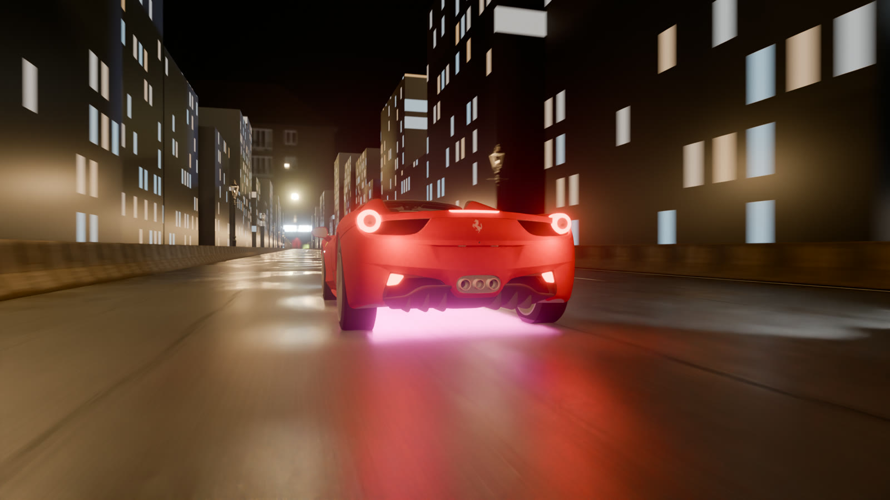
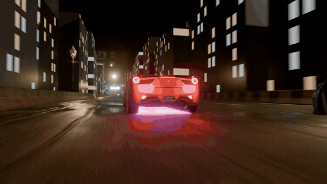
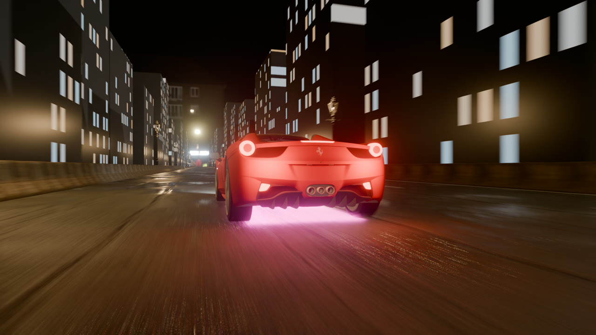
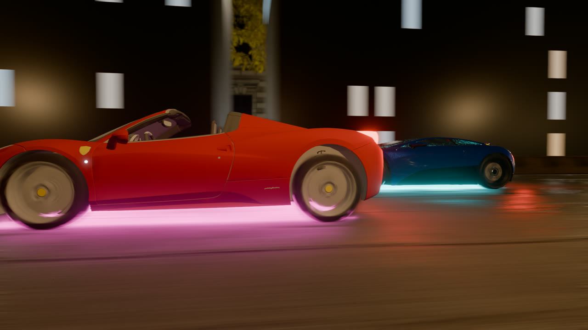
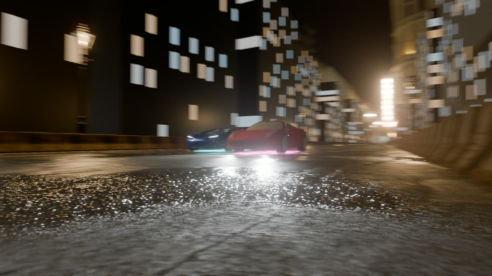
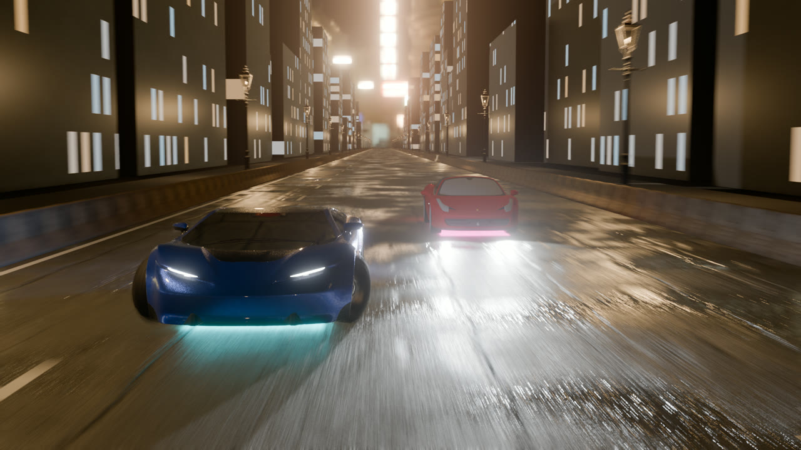
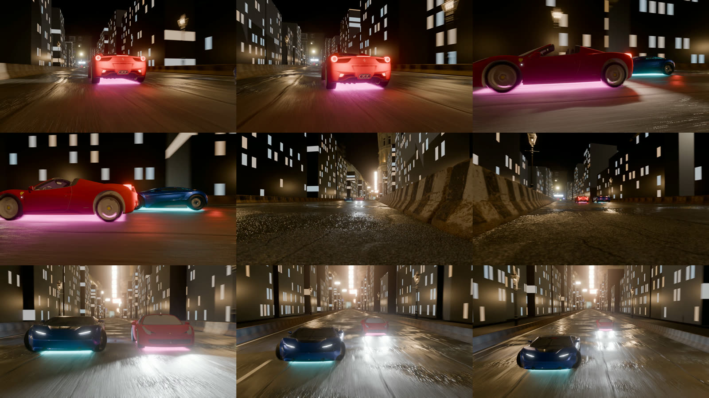

<div align="center">

# NFS Night Chase

### A 12-second street race at night, made in Blender
**My first Blender demo: two supercars, a wet neon street and four camera cuts, in the style of Need for Speed.**

[](https://www.blender.org) &nbsp;
[](#render-settings) &nbsp;
[](../../releases/latest) &nbsp;
[](LICENSE)

<br>


<br><sub><i>Chase camera, rendered in Cycles.</i></sub>

</div>

---

> This is the first thing I have made in Blender. The goal was a short, game-style chase shot that looks like a
> scene from Need for Speed: night city, wet asphalt, glowing underbodies, fast camera cuts. Everything here,
> including the `.blend`, is the actual project, so you can open it and see how it is put together.

**Contents:** [Watch](#watch) · [The four shots](#the-four-shots) · [What's in the scene](#whats-in-the-scene) ·
[How it was made](#how-it-was-made) · [Render settings](#render-settings) · [Open it yourself](#open-and-render-it-yourself) ·
[How the files are stored](#how-the-blend-and-assets-are-stored) · [Layout](#project-layout) · [Credits](#credits--licence)

---

## Watch

<div align="center">

[](../../releases/latest/download/nfs_night_chase_1080p.mp4)

**[▶ Full 1080p video (MP4, 12 s)](../../releases/latest/download/nfs_night_chase_1080p.mp4)** · the preview above is a reduced GIF

</div>

---

## The four shots

The edit cuts between four cameras. Each camera is switched in by a timeline marker, so the whole film is one
continuous Blender animation with no editing afterwards.

<table>
<tr>
<td width="50%" valign="top">

<br><sub><b>1 · Chase (0–3 s).</b> Low camera behind the red Ferrari, creeping closer. Magenta underglow on the wet road.</sub>
</td>
<td width="50%" valign="top">

<br><sub><b>2 · Side track (3–5.7 s).</b> Wheel-height tracking shot; the wheels spin with real distance-over-radius rotation, and the blue car closes in behind.</sub>
</td>
</tr>
<tr>
<td width="50%" valign="top">

<br><sub><b>3 · Fly-by (5.7–8.3 s).</b> Locked-off camera at the kerb, panning as both cars blast past.</sub>
</td>
<td width="50%" valign="top">

<br><sub><b>4 · Front crane (8.3–12 s).</b> Camera ahead of the pack, rising; the blue car hits nitro and takes the lead.</sub>
</td>
</tr>
</table>

<details>
<summary>Contact sheet (9 frames across the whole run)</summary>
<br>

</details>

---

## What's in the scene

| Part | What it is | Source |
|---|---|---|
| **Red car** | Ferrari 458 Italia, emissive head/tail lamps, magenta underglow, headlight spots | three.js example model by vicent091036 |
| **Blue car** | Car Concept repainted metallic blue, cyan underglow, nitro light from 8.3 s | Khronos glTF sample (CC BY 4.0) |
| **Road** | 900 m × 14 m street, lane dashes and edge lines, kerbs | Asphalt 02 texture (Poly Haven, CC0) |
| **Wet look** | Roughness map darkened ×0.55 plus noise-driven puddles that are almost mirror-smooth | Built in the shader |
| **Barriers** | Checkered concrete barriers, arrayed along both sides | Concrete Road Barrier (Poly Haven, CC0) |
| **Street lamps** | 40 lamps, every 40 m, each with a warm point light | Street Lamp 01 (Poly Haven, CC0) |
| **Skyline** | 63 building blocks with a procedural lit-window material (brick texture → emission) | Made for this scene |
| **Sky** | Night HDRI at 0.6 strength | Hansaplatz (Poly Haven, CC0) |
| **Cameras** | 4 cameras with Track To targets, depth of field at f/4, slight handheld shake | Made for this scene |

The `.blend` is organised into collections: **Cars** (one sub-collection per car), **Road**, **Street props**,
**Buildings**, **Street lights**, **Cameras**, and a hidden **Asset sources** collection holding the original
barrier and lamp that the copies are made from.

---

## How it was made

1. **Assets first.** Lighting, road texture, barriers and lamps came from Poly Haven; the two cars are free
   glTF models. Nothing on screen is a grey placeholder, apart from the deliberately simple building blocks.
2. **Motion as plain functions.** The Ferrari moves at a steady 50 m/s (180 km/h). The blue car starts 6 m behind,
   creeps up between 3 s and 8.3 s, then accelerates at 3 m/s² on nitro. The script checks that both cars always
   move forward and stay on the road before it keys anything.
3. **Scene built by script.** [`scripts/build_scene.py`](scripts/build_scene.py) builds the road, props, skyline,
   lights and cameras and keys every frame (cars, wheel spin, cameras, nitro). It can be re-run safely: it
   deletes what it made and rebuilds it.
4. **Look development.** Test frames at each stage, then fixes: dimmer windows, glow moved under the cars,
   shadowless street lamps (40 shadowed lights made frames 5× slower), headlight bloom tamed.
5. **Render and encode.** Eevee renders the 360 frames as PNGs; FFmpeg joins them into the MP4.

---

## Render settings

| Setting | Eevee (the video) | Cycles (hero still) |
|---|---|---|
| Resolution | 1920 × 1080, 30 fps, 360 frames | 1920 × 1080 |
| Samples | 16 | 128, adaptive, OpenImageDenoise |
| Motion blur | On, shutter 0.4, 4 steps | On |
| Extras | Ray tracing on; compositor Bloom (threshold 2, strength 0.5) | GPU (OptiX), indirect clamp 10 |
| Colour | AgX, Punchy look | AgX, Punchy look |
| Time per frame (RTX 4070 Ti) | about 3.3 s (≈ 20 min for the film) | 6–10 s |

---

## Open and render it yourself

**Easiest:** download `nfs_night_chase_scene.zip` from the [latest release](../../releases/latest), unzip it, and
open `nfs_night_chase.blend` in Blender 5.2 or newer. Press **Space** to play in the viewport or **Ctrl+F12** to
render the animation. Keep the `textures` folder next to the `.blend`.

**From the repository** (the same scene with textures as separate files):

```powershell
git lfs install
git clone https://github.com/deeptech760-stack/nfs-night-chase.git
cd nfs-night-chase
blender blender/nfs_night_chase.blend
```

Render from the command line without opening the interface:

```powershell
# the film, with the saved Eevee settings -> blender/renders/frames/
blender -b blender/nfs_night_chase.blend -a

# two Cycles test frames on the GPU (the .blend is not modified)
blender -b blender/nfs_night_chase.blend --python scripts/render_cycles.py -- --frames 60,300 --out renders/hq_

# join frames into a video
ffmpeg -framerate 30 -i blender/renders/frames/f_%04d.png -c:v libx264 -crf 18 -pix_fmt yuv420p nfs_night_chase.mp4
```

To change the race (speeds, camera timings, lamp spacing), edit the constants at the top of
`scripts/build_scene.py`, open it in Blender's **Scripting** tab and run it.

---

## How the .blend and assets are stored

Blender files are large binaries that git cannot diff, so the repo follows the usual studio setup:

- **Git LFS for binary data.** The `.blend`, textures, HDRI, glTF models and video go through
  [Git LFS](https://git-lfs.com) (see [`.gitattributes`](.gitattributes)). The repo stays quick to clone, and
  every version of the scene stays recoverable.
- **Textures as separate files with relative paths.** Textures are unpacked into `blender/textures/` and linked
  as `//textures/...`, so the scene opens on any machine and a texture change does not re-upload the whole
  `.blend`.
- **A ready-to-open download.** The release carries the scene and its textures as one zip, for anyone who just
  wants to open it without Git LFS.
- **Cleaned before publishing.** Blender files remember where things were imported from and which folders the
  file browser visited. Those records were cleared, so the file holds no paths from the machine it was made on.
- **Renders are never committed.** Frames are rebuilt from the `.blend`; only the final MP4 is published, as a
  release asset. Backup files (`.blend1`) are ignored.
- **Credits next to the assets.** Every third-party asset and its licence is listed in
  [`THIRD_PARTY_NOTICES.md`](THIRD_PARTY_NOTICES.md).

---

## Project layout

```
nfs-night-chase/
├── README.md
├── LICENSE                     ← MIT, for the scripts
├── THIRD_PARTY_NOTICES.md      ← every asset, author and licence
├── .gitattributes              ← which files go through Git LFS
├── blender/
│   ├── nfs_night_chase.blend   ← the scene (Blender 5.2)
│   └── textures/               ← road, barrier, street_lamp, hdri, cars/concept
├── assets/models/              ← the two car models as imported (.glb)
├── scripts/
│   ├── build_scene.py          ← builds and animates the whole scene
│   └── render_cycles.py        ← switches to Cycles on the GPU and renders frames
└── media/                      ← README images and the GIF preview
```

---

## What I'd improve next

- Real building models instead of the procedural blocks.
- Drivers in the cars (the Ferrari is a convertible, so the empty seat shows in the side shot).
- A closer, longer fly-by: the cars are small in frame and pass quickly.
- Engine and tyre sound.
- Lights retuned for Cycles so the whole film can be rendered at hero quality.

---

## Credits & licence

- **Scripts** (`scripts/`): MIT, see [`LICENSE`](LICENSE).
- **Renders and the scene layout**: © the author, [CC BY 4.0](https://creativecommons.org/licenses/by/4.0/).
- **Third-party assets** keep their own licences: Car Concept by the Khronos Group (CC BY 4.0), Ferrari 458 Italia
  by vicent091036, and Poly Haven assets (CC0). Details in [`THIRD_PARTY_NOTICES.md`](THIRD_PARTY_NOTICES.md).

*A personal learning project. Not affiliated with Electronic Arts, the Need for Speed series, or Ferrari.*
